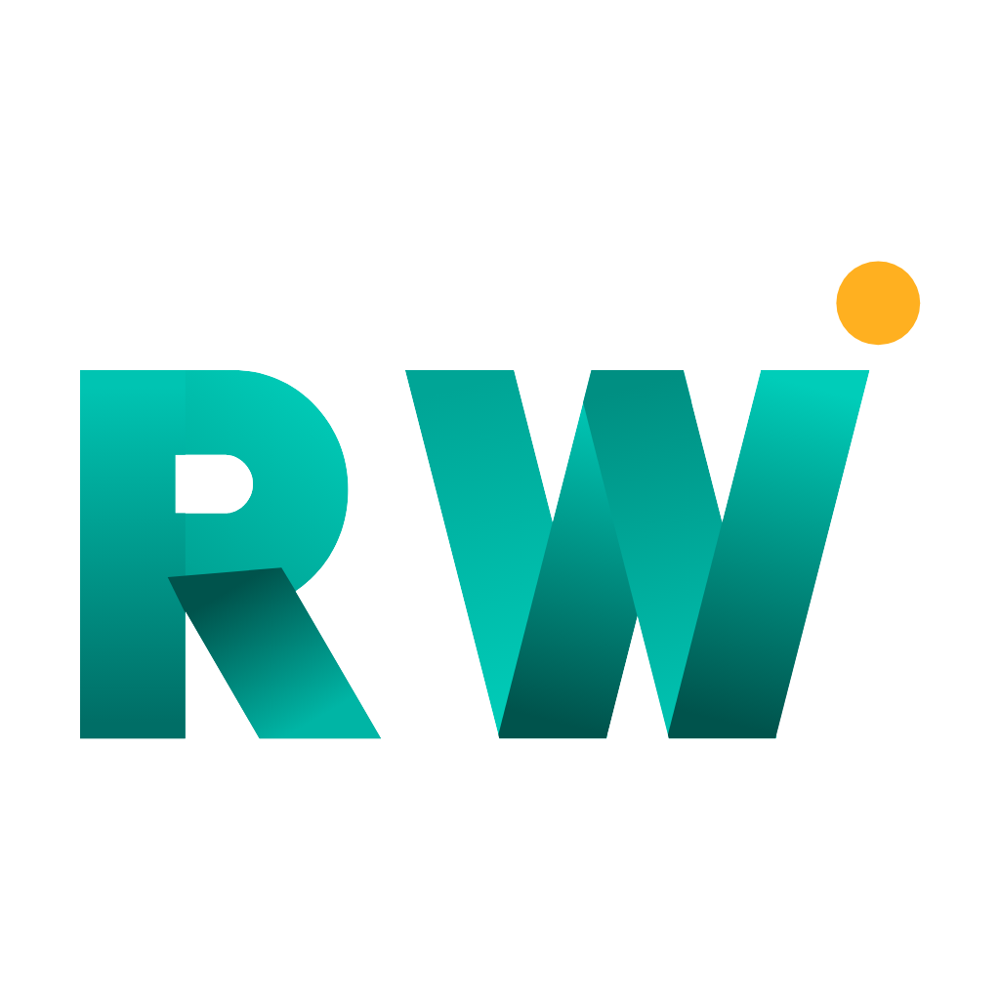

  

<h1 align="center">RW Digital Solutions</h1>

<b>Building digital products for Rwanda and Africa — from Kigali.</b> 
🌐 <a href="https://rwdigitalsolutions.com">rwdigitalsolutions.com</a>

## What we build
- Websites and web platforms
- Business systems (e.g. **RW Digital OS**, our internal staff portal)
- Data and digital solutions for agriculture, government and enterprise

## Working with us
- New to the team? Read our [Contributing Guide](https://github.com/rw-digital-solutions/.github/blob/main/CONTRIBUTING.md).
- Found a security issue? See our [Security Policy](https://github.com/rw-digital-solutions/.github/blob/main/SECURITY.md).
